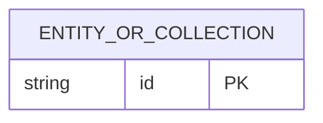

# ERD Document Format

Use this structure for every standalone ERD deliverable. Match the section order, heading labels, metadata style, Mermaid block, tables, numbered rules, decisions, SLA, and references in the supplied Game ERD example. Replace its domain content with the feature's actual data model; never copy its schema or business rules.

## Required structure

````markdown
# [Feature or Domain] ERD

> **Document Type:** ERD
> **Status:** Draft
> **Scope:** [Database engine, in-scope entities or collections, and consuming workflows]

## ERD



[Brief scope note or modeling constraint, if needed.]

## Table: `[entity_or_collection]`

| Column    | Data Type         | Null     | Key / Constraint                 | Description             |
| --------- | ----------------- | -------- | -------------------------------- | ----------------------- |
| `[field]` | [Type and bounds] | [Yes/No] | [Key, constraint, default, or —] | [Purpose and semantics] |

## Indexes

| Index          | Columns      | Type                                         | Purpose                   |
| -------------- | ------------ | -------------------------------------------- | ------------------------- |
| `[index_name]` | `[field(s)]` | [Unique / Non-unique / other supported type] | [Query or integrity need] |

## Relationships

| Parent                 | Child                  | Cardinality           | Rule                                              |
| ---------------------- | ---------------------- | --------------------- | ------------------------------------------------- |
| [Entity or collection] | [Entity or collection] | [1:1 / 1:N / N:M / —] | [Reference or embedding behavior, lifecycle rule] |

## Data Rules

1. [Confirmed validation, uniqueness, lifecycle, or consistency rule.]

## Decisions

- [Confirmed model decision, with source when available.]

## SLA Baseline

[Sourced service or API SLA and source. State explicitly when no target is defined.]

## References

- [BRD or requirement source]
- [Related IFA, LLD, or decision document]
````

Keep every section, even when no content is confirmed. Use `TBD` to show missing facts, and state what source or owner must confirm them. Use `None in current scope` for relationships only after checking the feature boundary.

## Modeling rules

- Identify the database engine and distinguish logical entities from physical tables or collections. Do not assume MongoDB unless a source or user instruction establishes it.
- For MongoDB, model collections and stored document fields. Show embedded objects/arrays or references where relevant; do not imply relational foreign keys. For relational databases, show tables, primary keys, foreign keys, and cardinality.
- Keep the Mermaid ERD, per-entity data dictionary, index list, relationships, and data rules consistent. Include only in-scope entities and fields.
- For each field, document storage name, type and applicable bounds, nullability, key/constraint/default, and business meaning. Mark unconfirmed values `TBD` rather than inferring a permanent schema from one API payload.
- Document indexes that support confirmed uniqueness or query/sort needs. For compound indexes, preserve field order. Include collation, partial-filter, TTL, or other index options only when supported by the database and required by an approved rule.
- Describe relationship cardinality, representation (embedding/reference/FK), and delete/update behavior. State when related domains are intentionally out of scope.
- Number data rules. Include validation, uniqueness, immutability, defaults, lifecycle, retention, soft-delete, and consistency behavior only when supported by requirements or approved decisions.
- In Decisions, record confirmed design choices and cite their source. Keep assumptions labeled as assumptions and unresolved decisions as `TBD`; never disguise them as approved decisions.
- In SLA Baseline, cite the approved BRD or service/API target. Clarify that API SLA describes end-to-end service behavior and is not a database-only guarantee. If no target exists, write `TBD`; do not invent availability, traffic, latency, CPU, or memory figures.
- Link actual source documents in References using valid relative paths or supplied URLs. Do not fabricate references.

## Status and language

- Use `Draft` by default. Use `Final` only when the source or user confirms approval; use `Example` only for an explicitly illustrative example.
- Default prose language follows the Solutioning Analyst skill's language rule. Keep database identifiers, field names, types, Mermaid syntax, and technical literals unchanged.
