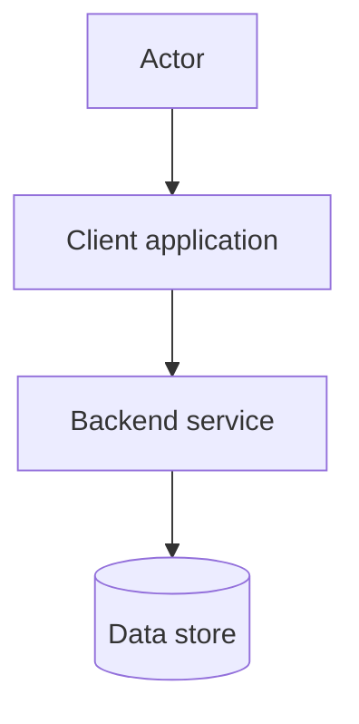

# HLD Document Format

Use this structure for every standalone High-Level Design (HLD) deliverable. Match the section order, headings, tables, diagram placement, and explanatory prose in the Sprint 1 HLD example. Replace its system and feature content with the current project's evidence; do not reuse its architecture, stack, security rules, flows, or SLA as defaults.

## Required structure

````markdown
# [Scope or Release] — High-Level Design

## Stack Teknologi

| Komponen    | Teknologi    | Tanggung jawab                  |
| ----------- | ------------ | ------------------------------- |
| [Component] | [Technology] | [Responsibility in this design] |

## Arsitektur Tingkat Tinggi


## Penjelasan Arsitektur

[Concise description of actors, application components, deployment, integrations,
security boundaries, persistence, and request/response paths.]

## Flowchart [Main Flow or Scope]



## Penjelasan Flow

- **[Flow name]:** [Behavior, checks, side effects, and outcome.]

## SLA Baseline

[Sourced targets or explicit TBD markers, scope, and measurement caveats.]

[Links to related IFA, ERD, and approved decisions, with a short note on what they cover.]
````

Produce the Markdown HLD and its architecture SVG in the same HLD directory. Follow the repository's established path and naming convention; use a paired scope slug for both files when creating new ones. Link the SVG with a relative Markdown path. Keep the Mermaid flowchart embedded in the HLD.

## Section guidance

- **Stack Teknologi:** list only in-scope components. Use the exact columns `Komponen`, `Teknologi`, and `Tanggung jawab`; describe each technology's role in this design.
- **Arsitektur Tingkat Tinggi:** include a separate, valid SVG architecture diagram. Show the actors/clients, major application and platform components, integrations, data stores, and labeled communication paths needed to understand the system boundary. Keep the SVG consistent with the stack table and written architecture explanation.
- **Penjelasan Arsitektur:** narrate the main request path from user entry through deployment, backend decisions, and data access to the response. Include authentication, authorization, or security controls when they shape this architecture.
- **Flowchart:** embed a Mermaid `flowchart TD` for the main process. Include relevant success, validation, authorization, dependency-failure, and state-changing branches; do not force unrelated use cases into one diagram.
- **Penjelasan Flow:** add one concise bullet per important flow, with a bold flow label. Describe outcomes and side effects that matter to clients, business rules, or data integrity.
- **SLA Baseline:** cite the approved BRD, service target, or measured baseline and state the scope. Do not invent availability, VUser/throughput, latency, CPU, or memory targets. Use `TBD` and identify what must be confirmed when evidence is missing. Label proposed targets as assumptions, not commitments.
- **Related-document paragraph:** link applicable IFA documents for endpoint contracts, ERDs for persistent data design, and approved decisions or BRDs as needed. Do not duplicate detailed API contracts or the ERD in the HLD.

## Diagram consistency and delivery

- The SVG, Mermaid flowchart, stack table, and explanation must describe the same component names, technologies, integrations, and data stores.
- Use synthetic examples only. Do not expose secrets, credentials, private endpoints, or customer data.
- Ensure the SVG is readable at normal document width, has no clipped labels, and uses text labels rather than color alone to convey meaning.
- Keep the HLD high-level. Put request/response schemas in IFA and field/index/relationship detail in ERD.
- Update an existing HLD and diagram when requested; do not create duplicates or replace established project content without instruction.
